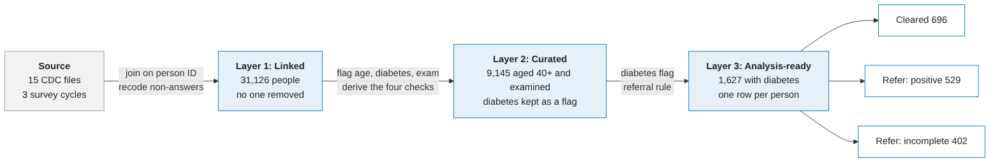

```{r setup, include=FALSE}
# Hidden because it only sets options and loads packages; it has no output to read.
# Code is hidden throughout (echo = FALSE) so the report shows results only.
# All code is in this .Rmd and in 01_build_dataset.R, submitted alongside.
knitr::opts_chunk$set(echo = FALSE, warning = FALSE, message = FALSE,
                      fig.align = "center", fig.width = 8, fig.height = 4)

# rmdformats supplies the report theme. It must be installed before knitting starts,
# so README.md gives a one-line install command; it is listed here as well for completeness.
pkgs <- c("haven", "dplyr", "purrr", "tibble", "tidyr", "ggplot2", "survey", "knitr", "DT", "rmdformats")
for (p in pkgs) if (!requireNamespace(p, quietly = TRUE)) install.packages(p)
suppressPackageStartupMessages({
  library(dplyr); library(tidyr); library(ggplot2); library(survey); library(knitr); library(DT)
})

# Colour-blind-safe palette (Okabe-Ito)
pal <- c("#0072B2", "#D55E00", "#009E73", "#E69F00", "#CC79A7", "#56B4E9", "#999999")
```

```{r build, include=FALSE}
# Hidden because it runs the whole pipeline (01_build_dataset.R) once, building all
# three layers. It downloads the raw CDC files only if they are not already present.
invisible(capture.output(source("01_build_dataset.R")))
```

```{r estimates, include=FALSE}
# Hidden because it only computes the numbers quoted in the text, so none are typed in.
options(survey.lonely.psu = "adjust")
fmt <- function(x) format(x, big.mark = ",")
pc  <- function(x) paste0(floor(x + 0.5), "%")   # rounds halves up (60.5 -> 61)
des <- svydesign(ids = ~psu, strata = ~strata, weights = ~weight, nest = TRUE,
                 data = mutate(ard, cleared = as.numeric(refer == 0)))
wpct <- function(x, w = ard$weight) round(100 * weighted.mean(x, w, na.rm = TRUE), 1)
e <- svymean(~cleared, des)
cleared <- c(est = 100 * coef(e)[[1]], lo = 100 * confint(e)[1, 1], hi = 100 * confint(e)[1, 2])

# Counts at each layer
n_l1 <- nrow(layer1); n_age <- sum(raw$flag_age40); n_l2 <- nrow(layer2)
n_dm_any <- attrition$n[3]
n_hba1c_only <- sum(raw$flag_age40 & raw$flag_diabetes & !raw$dm_diagnosed, na.rm = TRUE)
n_total <- nrow(ard); n_cleared <- sum(ard$refer == 0)
n_pos <- sum(ard$refer_reason == "refer: positive finding")
n_inc <- sum(ard$refer_reason == "refer: screen incomplete")
pop_m <- sprintf("%.1f", sum(ard$weight) / 1e6)
age_clear <- round(mean(ard$age[ard$refer == 0])); age_ref <- round(mean(ard$age[ard$refer == 1]))

# Past ulcer by whether any examination component is missing (unweighted)
any_missing <- is.na(cohort$lops) | is.na(cohort$pad) | is.na(cohort$lesion_now)
ulc_missing  <- 100 * mean(cohort$ulcer_hx[any_missing],  na.rm = TRUE)
ulc_complete <- 100 * mean(cohort$ulcer_hx[!any_missing], na.rm = TRUE)

# Sensitivity analyses (Table 2)
c0 <- cohort
clear_if <- function(l, p, u, s) as.numeric(l %in% 0 & p %in% 0 & u %in% 0 & s %in% 0)
inc <- is.na(c0$at_risk)
scen <- tribble(
  ~Decision, ~Alternative, ~`Weighted % cleared`,
  "Main analysis", "None", wpct(clear_if(c0$lops, c0$pad, c0$ulcer_hx, c0$lesion_now), c0$wt),
  "Incomplete screens", "Dropped from the analysis", wpct(c0$at_risk[!inc] == 0, c0$wt[!inc]),
  "Incomplete screens", "Assumed normal", wpct(c0$at_risk %in% 0 | inc, c0$wt),
  "Loss of sensation", "1 numb site is enough", wpct(clear_if(c0$alt_lops_1site, c0$pad, c0$ulcer_hx, c0$lesion_now), c0$wt),
  "Ankle-brachial index", "Stiff arteries (1.3+) counted as normal", wpct(clear_if(c0$lops, c0$alt_pad_low_only, c0$ulcer_hx, c0$lesion_now), c0$wt),
  "Past ulcer", "Not used", wpct(clear_if(c0$lops, c0$pad, 0, c0$lesion_now), c0$wt),
  "Diabetes", "Diagnosed only (HbA1c-only excluded)",
    wpct(clear_if(c0$lops, c0$pad, c0$ulcer_hx, c0$lesion_now)[c0$dm_diagnosed], c0$wt[c0$dm_diagnosed])
)
s_drop <- pc(scen$`Weighted % cleared`[2]); s_norm <- pc(scen$`Weighted % cleared`[3])
```

# Coversheet

```{r coversheet, out.width="100%"}
include_graphics(c("figures/coversheet_p1.png", "figures/coversheet_p2.png", "figures/coversheet_p3.png"))
```

# Abstract

**Background:** Diabetic foot complications contribute substantially to morbidity, mortality and healthcare expenditure. Although routine foot risk assessment is recommended, not every person with diabetes requires specialist podiatry review. Identifying those who can remain in routine care requires reliable risk classification.

**Objective:** To develop an analysis-ready dataset and estimate the proportion of adults with diabetes aged 40 years and over who could avoid specialist podiatry referral using predefined clinical risk criteria.

**Methods:** Publicly available National Health and Nutrition Examination Survey (NHANES) data from 1999–2004 were linked, cleaned and curated. Diabetes was defined by reported medical diagnosis or HbA1c ≥6.5%. Four assessment domains were used: protective sensation, ankle–brachial pressure index (ABPI), previous ulceration and current foot lesions. Individuals were cleared only when all four assessments were available and negative. Positive or incomplete assessments resulted in referral classification.

**Results:** `r fmt(n_total)` participants were included, representing approximately `r pop_m` million US adults aged 40 years and over with diabetes. Of these, `r n_cleared` (weighted `r pc(cleared["est"])`) fulfilled clearance criteria. Another `r n_pos` had positive findings and `r n_inc` had incomplete assessments. Excluding incomplete assessments increased the estimated clearance proportion to `r s_drop`, while assuming missing assessments were normal increased it to `r s_norm`.

**Conclusion:** We have curated the data to show almost half the diabetics could avoid attending podiatric foot assessment. Missing clinical assessments were the principal determinant of uncertainty.

# 1. Introduction

Diabetic foot disease and its progression to ulceration, infection and ultimately amputation has high morbidity and mortality. Armstrong et al. (2017) estimated the lifetime risk of foot ulceration among people with diabetes at 19–34%. More recent data demonstrate a one-year mortality rate of 14.4% following a new diabetic foot ulcer (Holman et al., 2024). Hennessy et al. (2025) reported mortality of 23.6% at one year and 58.2% at five years following below-knee amputation in people with diabetes.

Prevention is the best strategy and early detection becomes paramount. NICE recommends foot risk assessment at diabetes diagnosis and at least annually thereafter. The assessment includes protective sensation, circulation, previous ulceration and other structural or skin abnormalities. Patients are subsequently classified into risk categories which determine the frequency of follow-up and the need for specialist services (NICE, 2015; Bus et al., 2024).

However, routine diabetic foot assessment and specialist podiatry review are not the same intervention. While all patients require appropriate risk assessment, not all require specialist follow-up. This distinction becomes increasingly important as diabetes prevalence increases. Diabetes UK (2025) reported 4.6 million people living with diagnosed diabetes in the UK in 2025, which is an increase of 1.3 million since 2016. Specialist podiatry capacity is finite, and inappropriate referrals can delay care for patients who genuinely require it.

The financial implications are considerable. Kerr et al. (2019) estimated that diabetic foot ulcers and amputations cost the NHS in England approximately £837–962 million annually. Improvements in diabetic foot services have also been associated with reductions in major amputation rates. Paisey et al. (2018) demonstrated this relationship across services in South West England, where my practice is based.

Pallin et al. (2024), in a review examining established screening principles, found a lack of evidence to support universal screening. It is a thin line between over-diagnosing the need for podiatry assessment and missing out on patients who need it. Therefore, having a well-curated dataset ready for choosing the right patients is needed.

PubMed and Google Scholar were searched using “diabetic foot screening”, “neuropathy”, “podiatry referral” and “NHANES”. Relevant NICE, IWGDF and CDC guidance was also reviewed. Previous research using NHANES foot examination data established the prevalence of lower-extremity disease in US adults with diabetes. Gregg et al. (2004) reported neuropathy in 28.5%, peripheral arterial disease in 9.5% and either condition in approximately 30.2% of adults with diabetes. These estimates describe disease burden rather than the proportion of patients requiring specialist assessment under a combined referral rule.

This work addresses that gap: rather than counting abnormalities, it curates the data into a classification of who would or would not trigger specialist referral.

**Research question:** Among adults aged 40 years and over with diabetes, what proportion have sufficient assessment findings to avoid specialist podiatry referral?

- **Population:** Adults aged 40 years or older with diabetes
- **Intervention or index approach:** Structured risk-based triage
- **Comparator:** Routine referral without this triage distinction
- **Outcome:** The proportion meeting clearance criteria.

This is an operational classification outcome rather than a clinical safety outcome.

- **Feasible** using public examination data
- **Interesting** because of its potential service implications
- **Novel** in its referral-oriented curation
- **Ethical** because it uses de-identified public data
- **Relevant** to diabetic foot service efficiency and delivery

# 2. Methods

## 2.1 Data source and study design

This was a secondary, cross-sectional analysis of the National Health and Nutrition Examination Survey (NHANES), covering 1999–2004 (Centers for Disease Control and Prevention, n.d.).

NHANES was selected because these historical cycles included objective foot examination measurements alongside diabetes history and demographic variables.

Participants aged 40 years and over were eligible because the relevant NHANES lower-extremity examination was conducted in this age group.

## 2.2 Governance and ethics

NHANES public-use datasets contain de-identified participant information. No separate institutional ethical approval was required for this analysis.

Data governance was considered through the Five Safes framework: safe projects, people, data, settings and outputs. The project had a defined research purpose, used openly available anonymised data and produced aggregate results without disclosing individual records.

The FAIR principles informed the data-processing approach. Data sources, variable transformations, classification rules and analytic outputs were documented to support findability, accessibility, interoperability and reusability.

Potential data hazards included missing clinical findings, inappropriate interpretation of examination codes, population selection bias and the risk of presenting a research classification as validated clinical advice (Data Hazards Project, n.d.:Ranks or Classifies People; May Cause Direct Harm; Reinforces Existing Biases; Danger of Misuse). These were managed through explicit phenotype definitions, conservative handling of incomplete screens and sensitivity analyses.

## 2.3 Data acquisition, cleaning and preparation

Data preparation was conducted in three stages to preserve traceability from the original source to the final analytical cohort (Figure 1; Appendix A3).

```{r fig-pipeline, out.width="100%", fig.cap="Figure 1. Data layers, the steps between them, and the number of people at each stage"}

```

The first layer linked demographic, questionnaire, laboratory and examination data for `r fmt(n_l1)` sampled individuals. Records were linked using the unique NHANES participant identifier, with one-to-one matching checks to detect possible duplication.

The second layer produced a curated population of `r fmt(n_l2)` examined participants aged 40 years or above. Of `r fmt(n_age)` age-eligible individuals, `r fmt(n_age - n_l2)` were excluded because they had not completed the examination required for this analysis.

Diabetes was identified in `r fmt(n_dm_any)` individuals, including `r n_hba1c_only` who met the HbA1c criterion without a reported medical diagnosis. Of these, `r fmt(n_total)` had attended the relevant examination and formed the final analysis-ready cohort.

Refused responses, unknown answers and invalid values were treated as missing rather than interpreted as negative findings.

The set has separate analysis flags for normal results, positive findings, technical limitations and entirely missing examinations.

All processing was done in R and R Markdown. The pipeline rebuilds all three layers from the original CDC files, with a data dictionary and cleaning log recording every definition, transformation, exclusion and missing-data decision (Appendix A1–A6), so researchers can reuse whichever layer suits them. Every number in the report is calculated at knitting, not typed in.

## 2.4 Clinical phenotype definitions and referral algorithm

The central principle guiding the phenotype definitions was sensitivity. This dataset is intended to identify people who could be considered for routine rather than specialist care, not to establish a definitive diagnosis. Where clinically important uncertainty remained, the individual was put in the referral group (Table 1; Appendix A4, A8).

```{r phenotypes}
pct_missing <- function(v) sprintf("%d (%.0f%%)", sum(is.na(v)), 100 * mean(is.na(v)))
tibble(
  Phenotype = c("Loss of sensation", "Abnormal ankle-brachial index", "Past ulcer",
                "Lesion now", "Refer (primary outcome)"),
  Rule = c("2 or more of 3 monofilament sites numb on the same foot; untested for a foot problem = positive; untested for a technical reason = normal",
           "Below 0.9 or 1.3 and above on either leg, or no ankle pulse, or pressure too high to measure; normal only if both legs measured",
           "Ever had a leg or foot sore taking over 4 weeks to heal",
           "Lesion seen on either foot at the exam",
           "Any check positive, or any check not completed; cleared only if all four done and normal"),
  `Missing, n (%)` = c(pct_missing(ard$lops), pct_missing(ard$pad), pct_missing(ard$ulcer_hx),
                       pct_missing(ard$lesion_now), "0 (0%)"),
  `Weighted %` = c(wpct(ard$lops), wpct(ard$pad), wpct(ard$ulcer_hx),
                   wpct(ard$lesion_now), wpct(ard$refer))
) %>% kable(caption = "Table 1. Phenotype definitions, completeness and prevalence")
```

**Diabetes:** A participant was classified as having diabetes when they reported a previous medical diagnosis or had an HbA1c of at least 6.5%. Including laboratory-defined diabetes reduced the possibility of excluding people with previously unrecognised disease.

**Protective sensation:** NHANES assessed monofilament sensation at three sites per foot. Loss of sensation was defined as failure to detect the monofilament at two or more sites on the same foot.

An untested foot was handled according to the reason recorded. A dressing, lesion, stocking, cast, amputation or callus preventing assessment was treated as a reason not to clear the patient. Technical or other non-clinical reasons were not themselves classified as evidence of neuropathy.

**Vascular assessment:** ABPI measurements were classified as abnormal when below 0.9 or at least 1.3. Low values may indicate peripheral arterial disease, whereas elevated values may reflect arterial incompressibility or calcification, particularly in diabetes.

**Previous ulceration:** Any reported previous ulcer of the leg or foot was treated as a positive risk indicator. The NHANES question did not distinguish diabetic foot ulceration from ulcers of other causes, but in the same vein it was included for referral.

This approximates, but is not identical to, NICE risk categorisation, because NHANES does not capture every required clinical feature; it is a precautionary research rule.

## 2.5 Statistical analysis and sensitivity testing

Descriptive analyses summarised the analytical cohort, the frequency of individual risk findings and the overall referral classification.

Six-year examination weights were constructed following CDC guidance (Johnson et al., 2013): two-thirds of the 1999–2002 four-year examination weight (WTMEC4YR) and one-third of the 2003–2004 two-year examination weight (WTMEC2YR). The survey's sampling clusters (PSUs) and strata were retained in the design so that confidence intervals were estimated correctly.

Sensitivity analyses tested the effect of alternative assumptions: excluding incomplete assessments, assuming incomplete assessments were normal, defining sensory loss after one numb site, treating elevated ABPI as normal, omitting previous ulcer history, and restricting diabetes identification to reported diagnosed cases.

# 3. Results

Of the `r fmt(n_total)` participants, `r n_cleared` had complete and reassuring results in all four risk domains. This corresponded to a weighted clearance estimate of `r pc(cleared["est"])` (95% CI `r sprintf("%.0f", cleared["lo"])`–`r pc(cleared["hi"])`). The remaining `r n_pos + n_inc` participants were classified for referral: `r n_pos` because of positive findings and `r n_inc` because their assessments were incomplete (Figure 2).

Participants meeting clearance criteria were younger than those referred, with mean ages of approximately `r age_clear` and `r age_ref` years respectively (unweighted; Appendix A7).

```{r fig-reasons, fig.cap="Figure 2. Main reason for referral, weighted to the US population"}
lev <- c("cleared", "lesion on foot now", "loss of sensation",
         "abnormal ankle-brachial index", "past ulcer only", "screen incomplete")
ard %>%
  group_by(reason = factor(refer_main_reason, lev)) %>%
  summarise(pct = 100 * sum(weight) / sum(ard$weight)) %>%
  ggplot(aes(x = reason, y = pct, fill = reason)) +
  geom_col(show.legend = FALSE) +
  geom_text(aes(label = sprintf("%.1f%%", pct)), vjust = -0.4, size = 3.5) +
  scale_fill_manual(values = pal) +
  labs(x = NULL, y = "Weighted %") +
  theme_minimal() + theme(axis.text.x = element_text(angle = 20, hjust = 1))
```

Missing assessment data were clinically important. Participants with at least one missing examination component reported previous ulceration more frequently than those with complete examinations (`r pc(ulc_missing)` versus `r pc(ulc_complete)`).

The sensitivity analyses showed that missing-data assumptions had the greatest influence on the estimated clearance proportion. Dropping incomplete screens increased clearance from `r pc(cleared["est"])` to `r s_drop`, and assuming missing examinations were normal increased it to `r s_norm` (Table 2).

```{r sensitivity}
kable(scen, caption = "Table 2. The main result under each alternative decision")
```

Integrity checks passed at every stage (Appendix A5): participant identifiers were unique, every join was one-to-one, the linked file had `r fmt(n_l1)` rows matching the demographic file, every examination, laboratory and questionnaire record had a matching demographic record, all survey weights were positive, and every variable was documented in the dictionary.

# 4. Discussion

## 4.1 Principal findings and contribution

The central finding is that approximately `r pc(cleared["est"])` of adults with diabetes aged 40 years or older met the predefined criteria for avoiding specialist podiatry referral after a complete negative risk assessment.

The main contribution is not a new diagnostic test. It is the transformation of a national survey into a clinically structured, analysis-ready dataset capable of distinguishing abnormal findings, reassuring findings and incomplete information. The curated dataset can also examine foot risk factors in people without diabetes using Layer 2, while the alternative-decision columns allow researchers to test different screening thresholds and referral rules.

This suggests an opportunity for differentiated pathways: clearly low-risk patients remain in routine assessment, while podiatry capacity is directed to those with positive or uncertain findings, who could then be seen sooner.

## 4.2 Alternative approaches

Excluding participants with incomplete examinations would have produced a cleaner analytical dataset, but at the cost of discarding people with potentially higher clinical risk.

Assuming missing findings were normal would maximise apparent efficiency but could falsely classify patients as low risk.

The primary rules were chosen to prioritise clinical caution over the highest possible clearance rate.

## 4.3 Limitations

First, the data are historical, covering 1999–2004, and reflect the US population rather than contemporary NHS patients. Diabetes treatment, vascular assessment, foot care organisation and population characteristics have changed substantially.

Second, NHANES used a three-site monofilament examination, whereas clinical assessment protocols may use a greater number of sites. Sensory loss classification may therefore differ from contemporary clinical practice.

Third, the ulcer history question included the leg as well as the foot and did not record when the ulcer occurred. The resulting phenotype may include venous or other non-diabetic ulcers.

Fourth, the vascular assessment was based on available ankle pressure measurements and did not comprehensively capture every element of a contemporary peripheral arterial disease assessment.

Additional clinical variables required for full NICE risk assessment, including certain deformity, callus, renal replacement and amputation-related criteria, were not comprehensively represented in the four-domain rule.

The dataset has no longitudinal clinical outcome data with which to calculate false-negative rates or demonstrate the safety of withholding specialist assessment.

## 4.4 Governance and responsible use

The main risk of applying this work clinically would be treating an operational research classification as a validated decision-support tool.

Any future implementation would require contemporary prospective validation, evaluation of false-negative referrals, assessment of demographic subgroup performance and clear clinical accountability.

# 5. Conclusion

This project demonstrates how careful data curation can convert historical population survey data into a clinically interpretable diabetic foot referral classification.

The most important methodological finding is the influence of missing data. Assuming incomplete assessments were normal increased clearance to `r s_norm`, highlighting the risk of overstating service savings through inappropriate data handling.

The dataset is suitable for estimating the potential scale of risk-based triage and examining how classification decisions alter referral demand. It is not sufficient to establish that the pathway is clinically safe.

Prospective validation using contemporary NHS data and longitudinal ulcer outcomes would be required before clinical deployment.

# Use of generative artificial intelligence

Claude Opus 5.5 was used for code generation, grammar and spelling checks, and table creation and arrangement. I changed the code for my joins and patterns. I reviewed and accepted or edited every suggested change to the text, and checked that all numbers in tables match with the code.

# References

Armstrong, D.G., Boulton, A.J.M. and Bus, S.A. (2017) 'Diabetic foot ulcers and their recurrence', *New England Journal of Medicine*, 376(24), pp. 2367–2375. doi:10.1056/NEJMra1615439.

Bus, S.A., Sacco, I.C.N., Monteiro-Soares, M. et al. (2024) 'Guidelines on the prevention of foot ulcers in persons with diabetes (IWGDF 2023 update)', *Diabetes/Metabolism Research and Reviews*, 40(3), e3651. doi:10.1002/dmrr.3651.

Centers for Disease Control and Prevention, National Center for Health Statistics (n.d.) *National Health and Nutrition Examination Survey data, 1999–2004*. Hyattsville, MD: US Department of Health and Human Services. Available at: https://wwwn.cdc.gov/nchs/nhanes/ (Accessed: 18 November 2026).

Data Hazards Project (n.d.) *Data Hazard labels*. Available at: https://datahazards.com/labels.html (Accessed: 18 November 2026).

Diabetes UK (2025) *One in five adults now live with diabetes or prediabetes in the UK* [Press release], 6 February.

Gregg, E.W., Sorlie, P., Paulose-Ram, R. et al. (2004) 'Prevalence of lower-extremity disease in the US adult population ≥40 years of age with and without diabetes', *Diabetes Care*, 27(7), pp. 1591–1597. doi:10.2337/diacare.27.7.1591.

Hennessy, C., Abram, S., Brown, R., Loizou, C., Sharp, R. and Kendal, A. (2025) 'All-cause mortality, re-amputation and readmission rates following below-knee amputation in people with diabetes, England', *medRxiv* [Preprint]. doi:10.1101/2025.03.10.25323685.

Holman, N., Yelland, A.C., Young, B., Valabhji, J., Jeffcoate, W. and Game, F. (2024) 'Mortality rates in people presenting with a new diabetes-related foot ulcer: a cohort study with implications for management', *Diabetologia*, 67(12), pp. 2691–2701. doi:10.1007/s00125-024-06262-w.

Johnson, C.L., Paulose-Ram, R., Ogden, C.L. et al. (2013) 'National Health and Nutrition Examination Survey: analytic guidelines, 1999–2010', *Vital and Health Statistics. Series 2*, (161), pp. 1–24.

Kerr, M., Barron, E., Chadwick, P. et al. (2019) 'The cost of diabetic foot ulcers and amputations to the National Health Service in England', *Diabetic Medicine*, 36(8), pp. 995–1002. doi:10.1111/dme.13973.

National Institute for Health and Care Excellence (NICE) (2015) *Diabetic foot problems: prevention and management* (NICE guideline NG19, updated 2023). London: NICE.

Paisey, R.B., Abbott, A., Levenson, R. et al. (2018) 'Diabetes-related major lower limb amputation incidence is strongly related to diabetic foot service provision and improves with enhancement of services: peer review of the South-West of England', *Diabetic Medicine*, 35(1), pp. 53–62. PMID: 29023974.

Pallin, J.A., Connell, L., McIntosh, C. et al. (2024) 'Evaluating and mapping the evidence that screening for diabetic foot disease meets the criteria for population-wide screening: a scoping review', *BMJ Public Health*, 2(1), e000561. doi:10.1136/bmjph-2023-000561.

# Appendix (not counted in the main body)

## A1. How to use this dataset

1. Open the project folder in RStudio (R 4.3 or later).
2. Knit this file. It runs `01_build_dataset.R`, which downloads the 15 raw CDC files into `data_raw/` if they are not already there.
3. All outputs are written to `data_ard/`.

**Which layer to use:**

- **Layer 1, linked** (`layer1_linked.rds`, `r fmt(n_l1)` people): every source file joined, non-answers recoded. Start here for any NHANES 1999–2004 question.
- **Layer 2, curated** (`layer2_curated.rds`, `r fmt(n_l2)` people): aged 40+ and examined, all four foot checks derived, diabetes and alternative decisions as flags. Start here to study foot findings with or without diabetes, or to change a decision.
- **Layer 3, analysis-ready** (`foot_risk_ard.csv` / `.rds`, `r fmt(n_total)` people): people with diabetes, with the referral outcome. Start here to repeat this analysis.

## A2. Source files

```{r s-sources}
tibble::tribble(
  ~File, ~Content,
  "DEMO", "Age, sex, ethnicity, survey design and weights",
  "DIQ", "Diabetes diagnosis; past slow-healing ulcer",
  "LAB10 / L10", "HbA1c",
  "LEXPN", "Monofilament test; foot lesions; reasons untested",
  "LEXABPI / LEXAB", "Ankle-brachial index"
) %>% kable(caption = "Table A2. Source files, each for 1999–2000, 2001–02 and 2003–04")
```

## A3. Cohort attrition

```{r s-attrition}
attrition %>% mutate(removed = lag(n) - n) %>%
  kable(col.names = c("Rule", "People remaining", "Removed"), format.args = list(big.mark = ","),
        caption = "Table A3. Cohort attrition")
```

## A4. Cleaning and derivation log

```{r s-log}
datatable(log, caption = "Table A4. Cleaning and derivation log",
          colnames = c("Step", "Variable", "Decision", "Reason", "People affected"),
          extensions = "Buttons", rownames = FALSE,
          options = list(dom = "Bfrtip", buttons = c("csv", "excel"), pageLength = 15))
```

## A5. Integrity checks

```{r s-checks}
tibble(Check = c("One row per person in every source file",
                 "Joins neither dropped nor duplicated anyone (linked rows = demographics rows)",
                 "No exam, lab or questionnaire record without a matching demographics record",
                 "Participant ID unique across cycles and in every layer",
                 "Every person in the cohort has a positive survey weight",
                 "Every dataset column is documented in the dictionary, and vice versa"),
       Result = "Passed (the build stops if any check fails)") %>%
  kable(caption = "Table A5. Integrity checks")
```

## A6. Data dictionary (analysis-ready layer)

```{r s-dictionary}
datatable(dictionary, caption = "Table A6. Data dictionary (analysis-ready layer)",
          extensions = "Buttons", rownames = FALSE,
          options = list(dom = "Bfrtip", buttons = c("csv", "excel"), pageLength = 25))
```

## A7. Cohort characteristics by screening result

```{r table-cohort}
desc <- function(d) format(c(
  N = nrow(d),
  `Age, mean` = round(mean(d$age), 1),
  `Female, %` = round(100 * mean(d$sex == "Female"), 1),
  `Diagnosed by doctor, %` = round(100 * mean(d$dm_source == "told by a doctor"), 1),
  `HbA1c, mean %` = round(mean(d$hba1c, na.rm = TRUE), 1)), drop0trailing = TRUE)
tibble(Characteristic = names(desc(ard)),
       All = desc(ard),
       Cleared = desc(filter(ard, refer == 0)),
       `Refer: positive` = desc(filter(ard, refer_reason == "refer: positive finding")),
       `Refer: incomplete` = desc(filter(ard, refer_reason == "refer: screen incomplete"))) %>%
  kable(caption = "Table A7. Cohort characteristics by screening result (unweighted)")
```

## A8. The referral rule (code)

The code below is read directly from `01_build_dataset.R`, so it is the code that ran.

```{r show-rule, echo=TRUE, eval=FALSE, code=local({s <- readLines("01_build_dataset.R"); s[(grep(">>> REFERRAL RULE", s) + 1):(grep("<<< END REFERRAL RULE", s) - 1)]})}
```

## A9. R session information

```{r session}
sessionInfo()
```
